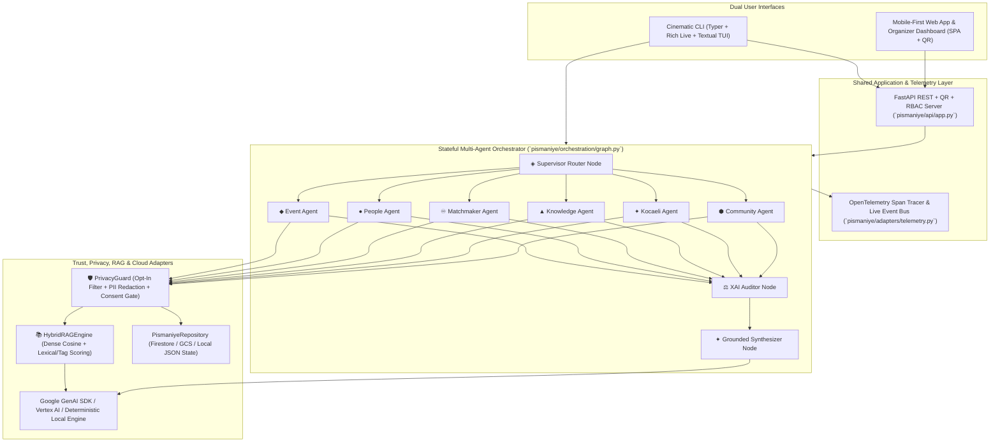
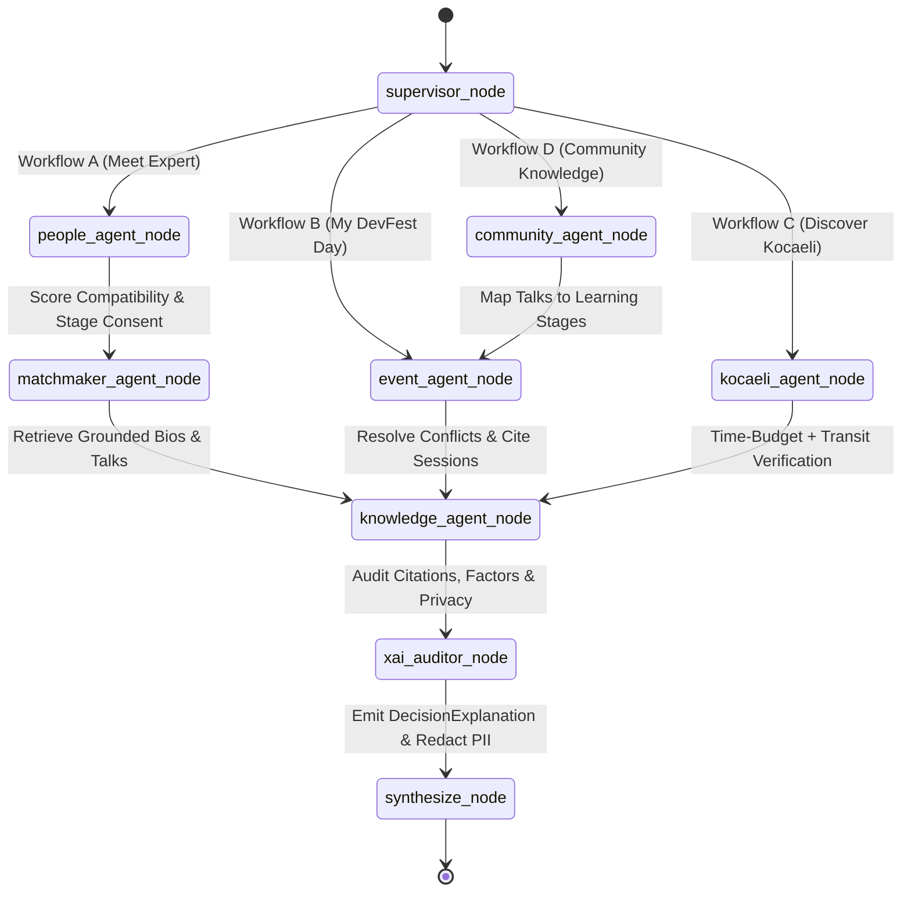
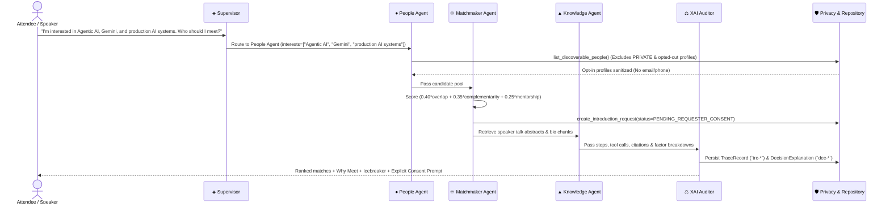
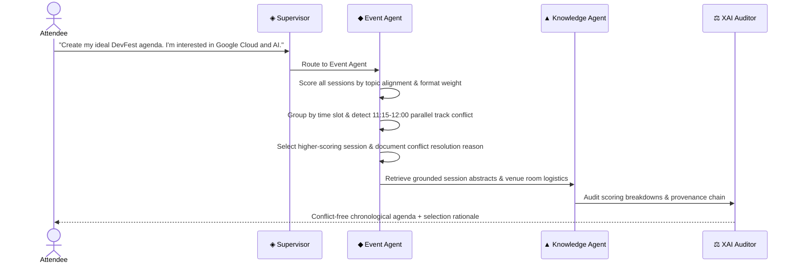
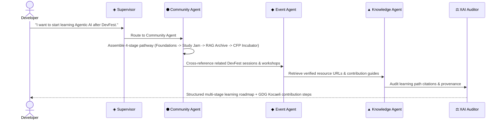

# PISMANIYE — System Architecture & Agentic Engineering Blueprint

> **Author & Principal Architect:** [Mortadha Mannai (@MortadhaMannai)](https://github.com/MortadhaMannai)
> **Community:** GDG Kocaeli & DevFest Kocaeli 2026
> **Tagline:** *"Unraveling People. Connecting Possibilities."*

---

## 1. High-Level Multi-Agent System Architecture



---

## 2. LangGraph Stateful Execution Graph (`StateGraph`)

Pismaniye uses an explicit `langgraph.graph.StateGraph` (`OrchestrationGraphState`) where the `Supervisor Router` classifies user intent and dynamically sequences the required specialist nodes before mandatory verification by the `XAI Auditor`:



---

## 3. Sequence Diagrams of the 4 Signature Agentic Workflows

### Workflow A — Meet the Right Expert (Consent-Gated Matchmaking)


### Workflow B — My DevFest Day (Conflict-Free Schedule Builder)


### Workflow C — Discover Kocaeli (Time-Boxed Local Concierge)
```mermaid
sequenceDiagram
    actor User as Visiting GDE / Speaker
    participant Sup as ◈ Supervisor
    participant KOC as ✦ Kocaeli Agent
    participant RAG as ▲ Knowledge Agent
    participant XAI as ⚖ XAI Auditor

    User->>Sup: "I'm a visiting GDE. I have three free hours. Help me discover Kocaeli."
    Sup->>KOC: Route to Kocaeli Agent (hours=3.0 -> 180 min budget)
    KOC->>KOC: Reserve 15m venue return buffer (165m usable window)
    KOC->>KOC: Evaluate transit_minutes + visit_duration_minutes & opening hours
    KOC->>KOC: Select Sekapark (70m) + İzmit Clock Tower (60m) = 145m total; defer Ormanya (220m)
    KOC->>RAG: Cite local cultural & heritage documents
    RAG->>XAI: Audit time-budget fit & verification status
    XAI-->>User: Practical 3-hour itinerary + deferred longer excursions
```

### Workflow D — Community Knowledge (Post-DevFest Learning Path)


---

## 4. Trust, Privacy & Data Provenance Architecture

```mermaid
flowchart LR
    subgraph Input["Raw Profile / Document"]
        RAW["PersonProfile (includes private_email, private_phone, opt_in_networking)"]
    end

    subgraph Guard["PrivacyGuard (`pismaniye/privacy/guardrails.py`)"]
        OPT["1. Opt-In & Visibility Check (`opt_in_networking == True` & `visibility != PRIVATE`)"]
        SER["2. Schema Exclusion (`exclude={'private_email', 'private_phone'}`)"]
        REG["3. Output Regex PII Redactor (`[REDACTED-EMAIL-CONSENT-REQUIRED]`)"]
        CON["4. Consent Gate (`PENDING_REQUESTER_CONSENT` -> `APPROVED_AND_LOGGED`)"]
    end

    subgraph Audit["XAI & Immutable Audit Log"]
        BADGE["Verification Badge (`SYNTHETIC_SAMPLE` | `VERIFIED_ORGANIZER_DATA` | `GENERATED_SUGGESTION`)"]
        LOG["AuditLogEntry + Right-to-Erasure (`DELETE /api/privacy/profile/{id}`)"]
    end

    RAW --> OPT --> SER --> REG --> CON --> BADGE --> LOG
```


