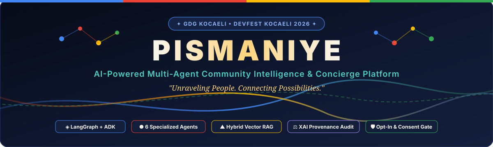
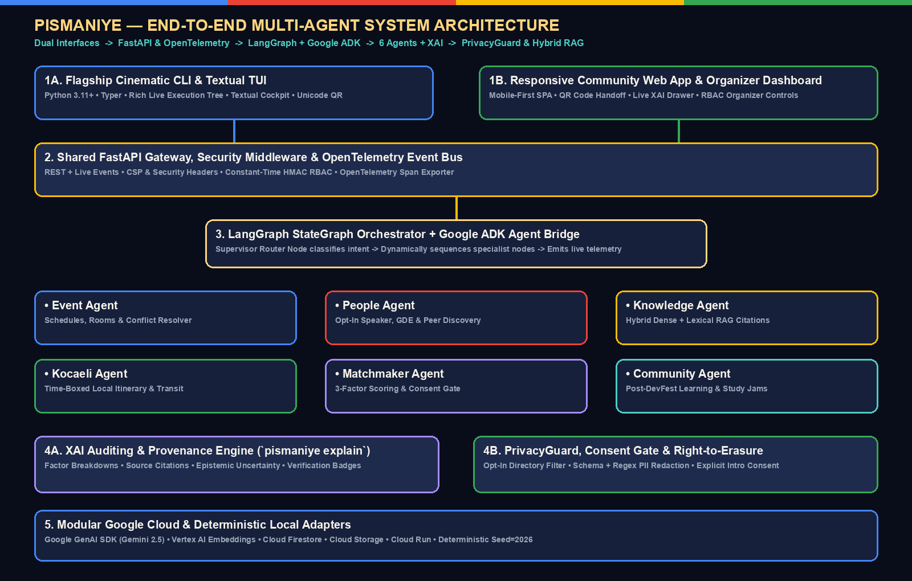
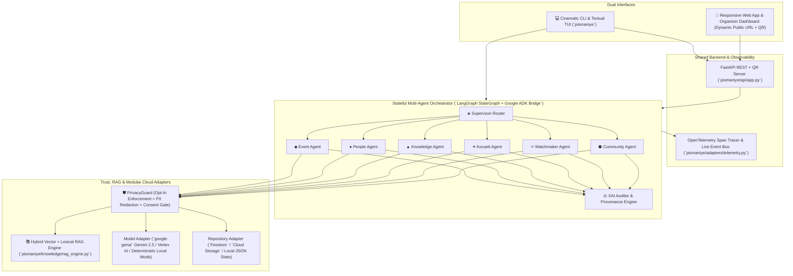
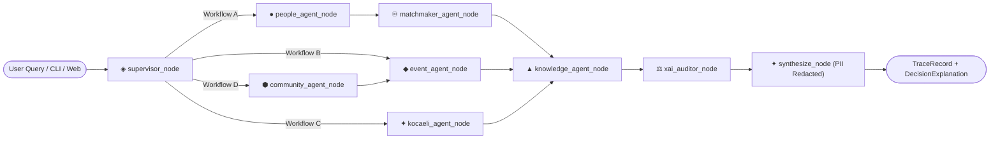
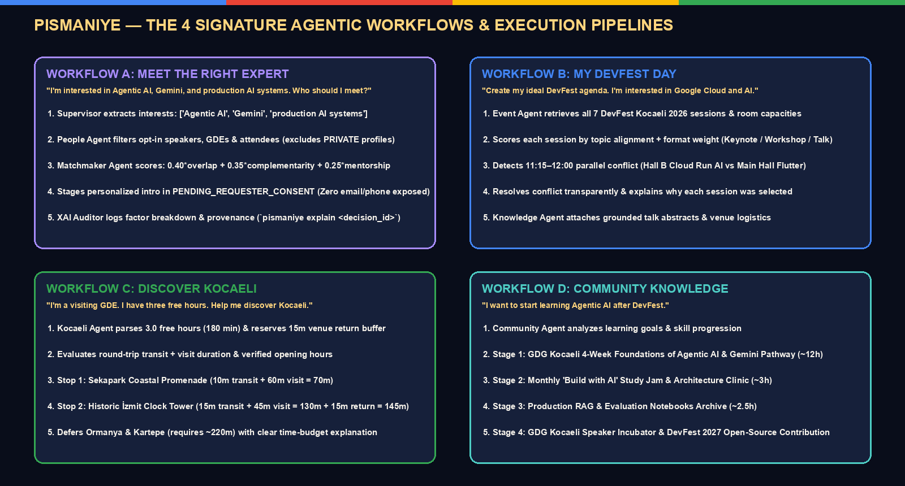

<div align="center">



<br />.   

[](.github/workflows/ci.yml)
[](pyproject.toml)
[](pismaniye/orchestration/graph.py)
[](pismaniye/adapters/google_cloud.py)
[](LICENSE)
[](https://github.com/MortadhaMannai)

**An AI-Powered Multi-Agent Community Intelligence & Concierge Platform built for GDG Kocaeli & DevFest Kocaeli 2026.**
*"Unraveling People. Connecting Possibilities."*

[✨ Vision](#-1-product-vision--philosophy) •
[📄 PDF Guide & Diagrams](docs/PISMANIYE_Architecture_Design_and_User_Guide.pdf) •
[🏗️ Architecture](#️-2-system-architecture--diagrams) •
[🤖 6 Agents + XAI](#-3-six-specialized-agents--xai-auditing-engine) •
[⚡ 4 Workflows](#-4-signature-agentic-workflows) •
[📦 Requirements & Setup](#-5-requirements--installation) •
[🚀 How to Run It Yourself](#-6-how-to-run-it-yourself-step-by-step-workflows) •
[🖥️ CLI & Web Interfaces](#️-7-complete-cli--rest-api-reference) •
[☁️ Cloud Run & CI/CD](#️-8-ci-cd-testing--google-cloud-deployment)

</div>

---

## 🌟 1. Product Vision & Philosophy

**Pismaniye** is named after Kocaeli's iconic Turkish dessert, *Pişmaniye*, whose delicate intertwined threads symbolize bringing together developers, ideas, expertise, and communities into something greater.

Designed by **[Mortadha Mannai (@MortadhaMannai)](https://github.com/MortadhaMannai)** as a flagship technical showcase and reusable long-term community platform for **GDG Kocaeli** (supporting **DevFest Kocaeli 2026**, **DevFest Kocaeli 2027**, and year-round *Build with AI* Study Jams), Pismaniye is **not** a generic chatbot or static FAQ app—it is a **stateful, observable, privacy-first multi-agent community intelligence platform**.

### Who It Serves
- **International DevFest Speakers & Visiting Google Developer Experts (GDEs)**: Time-boxed local Kocaeli discovery, peer networking, and mentorship matching.
- **GDG Kocaeli Organizers**: Full RBAC-protected Organizer Dashboard to manage schedules, speakers, knowledge base ingestion, moderation queues, analytics reports, and multi-year edition resets.
- **Local & International Attendees**: Personalized conflict-free schedule building, opt-in expert discovery, consent-gated introductions, and post-DevFest learning pathways.

---

## 🏗️ 2. System Architecture & Diagrams

> 📄 **Downloadable PDF Blueprint & Visual Assets:**
> - [**`docs/PISMANIYE_Architecture_Design_and_User_Guide.pdf`**](docs/PISMANIYE_Architecture_Design_and_User_Guide.pdf) — Complete 4-page PDF Architecture, Visual Design System & Step-by-Step User Guide
> - [**`assets/architecture-system-diagram.png`**](assets/architecture-system-diagram.png) & [**`assets/architecture-system-diagram.svg`**](assets/architecture-system-diagram.svg) — High-Resolution System Architecture Diagram
> - [**`assets/workflow-execution-diagram.png`**](assets/workflow-execution-diagram.png) & [**`assets/workflow-execution-diagram.svg`**](assets/workflow-execution-diagram.svg) — 4 Signature Agentic Workflows Diagram
> - [**`ARCHITECTURE.md`**](ARCHITECTURE.md) & [**`SECURITY.md`**](SECURITY.md) — Deep-dive sequence diagrams & zero-secret security policy

Pismaniye powers **two synchronized interfaces**—a **Cinematic Terminal CLI/TUI** (`Typer` + `Rich` + `Textual`) and a **Responsive Mobile-First Web App & Organizer Dashboard** (`FastAPI` + `Dynamic QR Handoff`)—over a shared **LangGraph + Google ADK + Hybrid RAG + Explainable AI (XAI)** core.

<div align="center">
  
</div>
 
### Interactive Architecture Flowchart



### LangGraph Stateful Execution Flow (`StateGraph`)



> 📖 For full sequence diagrams of all 4 workflows and privacy boundary schemas, see [**ARCHITECTURE.md**](ARCHITECTURE.md).

---

## 🤖 3. Six Specialized Agents + XAI Auditing Engine

| Agent | Agent ID | Specialization & Grounded Responsibilities | Registered Backend Tools |
| :--- | :--- | :--- | :--- |
| **◈ Supervisor Router** | `supervisor` | Decomposes user intent, selects the optimal workflow, and routes state across specialist nodes. | `route_stateful_workflow` |
| **◆ Event Agent** | `event_agent` | Understands schedules, sessions, workshops, and venue logistics; detects & resolves parallel track conflicts. | `query_schedule`, `build_conflict_free_agenda`, `get_venue_logistics` |
| **● People Agent** | `people_agent` | Discovers speakers, GDEs, organizers, and **explicitly opted-in** attendees by interest, tech stack, and mentorship topics. | `discover_opt_in_people`, `lookup_speaker_sessions` |
| **▲ Knowledge Agent** | `knowledge_agent` | Performs hybrid dense cosine + lexical/tag RAG retrieval over talk abstracts, bios, community docs, and learning guides. | `hybrid_rag_search`, `cite_verified_sources` |
| **✦ Kocaeli Agent** | `kocaeli_agent` | Local Kocaeli discovery concierge; plans time-boxed itineraries factoring in round-trip venue transit buffers and opening hours. | `plan_kocaeli_itinerary`, `verify_opening_hours_and_transit` |
| **♾ Matchmaker Agent** | `matchmaker_agent` | Computes transparent multi-factor compatibility (`interest_overlap`, `expertise_complementarity`, `mentorship_alignment`), explains mutual value, drafts icebreakers, and stages **consent-gated** introductions. | `score_networking_matches`, `draft_consent_gated_introduction` |
| **⬢ Community Agent** | `community_agent` | Builds post-DevFest learning paths, recommends monthly *Build with AI* Study Jams, and guides CFP/open-source contributions. | `build_learning_pathway`, `recommend_community_contributions` |
| **⚖ XAI Auditor** | `xai_auditor` | Audits every execution trace: records factor breakdowns, source citations, epistemic uncertainty, verification badges (`SYNTHETIC_SAMPLE` vs `VERIFIED_ORGANIZER_DATA` vs `GENERATED_SUGGESTION`), and privacy checks. | `verify_provenance_and_privacy` |

---

## ⚡ 4. Signature Agentic Workflows

<div align="center">
  
</div>

1. **Workflow A — Meet the Right Expert (`WORKFLOW_A_MEET_THE_RIGHT_EXPERT`)**
   - *Prompt:* `"I'm interested in Agentic AI, Gemini, and production AI systems. Who should I meet?"`
   - *Execution:* Filters opt-in directory → scores candidates transparently across 3 weighted factors → explains mutual benefit → drafts personalized icebreaker → holds introduction in `PENDING_REQUESTER_CONSENT` until explicit consent is granted (`--grant-consent` or Web UI button). Never exposes private email or phone numbers.
2. **Workflow B — My DevFest Day (`WORKFLOW_B_MY_DEVFEST_DAY`)**
   - *Prompt:* `"Create my ideal DevFest agenda. I'm interested in Google Cloud and AI."`
   - *Execution:* Retrieves schedule → scores sessions against user interests → automatically resolves the `11:15–12:00` parallel track conflict between *Hall B (Scaling Production AI Systems on Cloud Run)* and *Main Hall (Flutter & Gemini)* → explains why each session was chosen.
3. **Workflow C — Discover Kocaeli (`WORKFLOW_C_DISCOVER_KOCAELI`)**
   - *Prompt:* `"I'm a visiting GDE. I have three free hours. Help me discover Kocaeli."`
   - *Execution:* Parses `3.0` hours (`180` min) → reserves a `15` min return buffer → plans a `145` min loop covering *Sekapark Coastal Promenade* (`10m` transit + `60m` visit) and *Historic İzmit Clock Tower* (`15m` transit + `45m` visit) with opening hours → defers longer excursions like *Ormanya & Kartepe* (`220m` required) with clear explanations.
4. **Workflow D — Community Knowledge (`WORKFLOW_D_COMMUNITY_KNOWLEDGE`)**
   - *Prompt:* `"I want to start learning Agentic AI after DevFest."`
   - *Execution:* Builds a 4-stage post-DevFest learning pathway linked to DevFest talks, monthly GDG Kocaeli *Build with AI* Study Jams, RAG evaluation notebooks, and the GDG Kocaeli Speaker/Maintainer Incubator.

---

## 📦 5. Requirements & Installation

### System Requirements
- **OS**: macOS, Linux, or Windows (WSL2)
- **Python**: `3.11+` (`3.12` recommended)
- **API Keys**: **None required for `local_deterministic` mode!** Works 100% offline/deterministically out of the box. Optional `GEMINI_API_KEY` or `GOOGLE_CLOUD_PROJECT` enables live Google GenAI SDK / Vertex AI / Firestore / Cloud Storage adapters.

### Core Tech Stack
| Layer | Technologies Used |
| :--- | :--- |
| **CLI & TUI** | `typer`, `rich` (Live execution trees, tables, progress bars), `textual` (Full-screen TUI cockpit), `qrcode` |
| **Web & API** | `fastapi`, `uvicorn[standard]`, Responsive Mobile-First SPA (`pismaniye/web/index.html`), SVG QR Generator |
| **Orchestration & AI** | `langgraph` (`StateGraph`), `google-genai` (Gemini 2.5 & `text-embedding-004`), `google-adk` bridge |
| **Data, Privacy & Schemas** | `pydantic` v2, `pydantic-settings`, `PrivacyGuard` (Opt-in & PII redaction), `HybridRAGEngine` |
| **Cloud & Observability** | `opentelemetry-api`, `opentelemetry-sdk`, Google Cloud Run, Firestore & GCS modular adapters |
| **Testing & Quality** | `pytest`, `pytest-asyncio`, `mypy` (100% type-checked across 30 source files), GitHub Actions CI/CD |

### Step-by-Step Installation

```bash
# 1. Clone the repository
git clone https://github.com/MortadhaMannai/Pismaniye-the-AI-powered-community-intelligence-for-GDG-Kocaeli-x-DevFest-Kocaeli-2026..git
cd Pismaniye-the-AI-powered-community-intelligence-for-GDG-Kocaeli-x-DevFest-Kocaeli-2026.

# 2. Create and activate a Python virtual environment
python3.12 -m venv .venv
source .venv/bin/activate

# 3. Install Pismaniye with development & test dependencies
pip install --upgrade pip setuptools wheel
pip install -e ".[dev]"

# 4. (Optional) Copy environment config if you want to customize ports or add GCP credentials
cp .env.example .env
```

---

## 🚀 6. How to Run It Yourself (Step-by-Step Workflows)

You can run Pismaniye on **any environment** (your own laptop, GitHub Codespaces, Google Cloud Shell, Docker, or Google Cloud Run) without any hardcoded `localhost` assumptions.

### Workflow 1: Stage Presentation & Cinematic Terminal Launch
```bash
# Activate virtualenv
source .venv/bin/activate

# 1. Run the flagship cinematic startup (renders ASCII logo, live subsystem latencies, QR code & readiness trace)
pismaniye launch --event devfest-kocaeli-2026

# 2. Or launch directly into the interactive concierge REPL (`pismaniye ›`)
pismaniye launch --event devfest-kocaeli-2026 --interactive

# 3. Or launch the full-screen interactive Textual TUI cockpit (keys 1-4 trigger Workflows A-D, 'q' quits)
pismaniye launch --event devfest-kocaeli-2026 --tui
```

### Workflow 2: Running Specialized Agent Queries & Inspecting XAI Provenance
```bash
# 1. Ask a natural-language question and watch the live LangGraph execution tree
pismaniye ask "I'm interested in Agentic AI, Gemini, and production AI systems. Who should I meet?"

# 2. Inspect the execution trace (step latencies, tool arguments, OpenTelemetry span ID)
pismaniye trace latest

# 3. Audit the XAI Decision Explanation (factor breakdown, RAG citations, epistemic uncertainty, privacy checks)
pismaniye explain latest

# 4. Grant explicit consent for the top recommended networking introduction
pismaniye people match --interest "Gemini" --grant-consent
```

### Workflow 3: Launching the Mobile QR Web App & Organizer Dashboard (Any Host / Cloud / Docker)
```bash
# Option A: Run directly via the CLI (binds to 0.0.0.0:8080 by default so it works in Codespaces, Cloud Shell, or LAN)
# Set PISMANIYE_PUBLIC_WEB_URL in .env to your public URL / Cloud Run URL so the stage QR code points to your live instance
pismaniye serve --host 0.0.0.0 --port 8080

# Option B: Run via Docker Compose
docker compose up --build
```
Then open your server URL (or forwarded port in Codespaces / Cloud Shell / Cloud Run) in your browser, or scan the dynamically generated SVG QR code (`/api/qr.svg`):
1. **🤖 Concierge & XAI Tab**: Click any of the 4 Signature Workflow pills or type a custom question, view the live execution trace and XAI citations, and click **Grant Consent** on staged introductions.
2. **👥 Speakers, GDEs & Matchmaker Tab**: Filter opt-in profiles by topic (`Agentic AI`, `Gemini`, `Google Cloud`, `LangGraph`) or trigger Matchmaker scoring.
3. **📅 Schedule & Agenda Tab**: Toggle between the full DevFest schedule and your conflict-free personalized agenda.
4. **🌊 Discover Kocaeli Tab**: Adjust your free hours (`1` to `12` hours) to dynamically compute a local itinerary with transit buffers.
5. **🚀 Learning & Community Tab**: Explore the 4-stage post-DevFest learning path or submit a new community resource into the moderation queue.
6. **🛠️ Organizer Dashboard Tab**: Authenticate with your Organizer RBAC passcode (`PISMANIYE_ORGANIZER_PASSCODE`) to import verified speakers (`VERIFIED_ORGANIZER_DATA`), publish schedule sessions, approve moderated submissions, export the JSON event report, or **Reset Edition for DevFest Kocaeli 2027**.

---

## 🖥️ 7. Complete CLI & REST API Reference

### CLI Commands (`pismaniye --help`)

| Command | Description |
| :--- | :--- |
| `pismaniye launch --event devfest-kocaeli-2026` | Cinematic terminal launch, subsystem telemetry, QR code & live showcase trace. |
| `pismaniye launch --interactive` / `--tui` | Launch into interactive REPL (`-i`) or full-screen Textual TUI (`--tui`). |
| `pismaniye ask "<question>"` | Execute the stateful multi-agent orchestrator on any natural language question. |
| `pismaniye agents` | Inspect all 6 specialized agents + Supervisor + XAI Auditor and their tools. |
| `pismaniye event schedule [--interest "<topic>"]` | View the full schedule & venue layout, or build a conflict-free personalized agenda. |
| `pismaniye people discover --interest "Agentic AI"` | Search opt-in speakers, GDEs, organizers, and attendees by topic. |
| `pismaniye people match --interest "Gemini" [--grant-consent]` | Score networking compatibility and stage/approve consent-gated introductions. |
| `pismaniye kocaeli explore --hours 3` | Generate a time-boxed Kocaeli cultural & culinary itinerary with transit buffers. |
| `pismaniye knowledge search "LangGraph"` | Run hybrid vector + lexical RAG search with chunk scores and source URIs. |
| `pismaniye trace <trace_id \| latest>` | Inspect an execution trace tree, tool invocations, and OpenTelemetry trace ID. |
| `pismaniye explain <decision_id \| latest>` | Inspect XAI factor scoring, RAG citations, uncertainty, and privacy checks. |
| `pismaniye doctor` | Run 6-point architecture diagnostics (Runtime, LangGraph/ADK, RAG, Privacy, OTel). |
| `pismaniye demo` | Run all 4 Signature Workflows (**A, B, C, D**) end-to-end with live telemetry. |
| `pismaniye serve [--host 0.0.0.0] [--port 8080]` | Launch the FastAPI Community Web Application & Organizer Dashboard. |

### REST API Endpoints (`/docs` on your deployed instance)

| Method & Path | Auth | Description |
| :--- | :---: | :--- |
| `GET /` | Public | Responsive Community Web Application & Organizer Dashboard SPA. |
| `GET /api/health` | Public | System health, active event config, RAG chunk stats, and ADK agent descriptors. |
| `GET /api/qr.svg` | Public | Dynamic SVG QR code for instant mobile handoff. |
| `POST /api/chat` | Public | Execute multi-agent orchestrator and return `TraceRecord` + live events. |
| `GET /api/schedule` | Public | Retrieve schedule, venue info, and optional conflict-free agenda (`?interest=...`). |
| `GET /api/people` | Public | Discover opt-in community profiles (`private_email` & `private_phone` stripped). |
| `POST /api/matchmaker` | Public | Run Matchmaker workflow and return multi-factor compatibility breakdowns. |
| `POST /api/introductions/{id}/consent` | Public | Record explicit requester consent for a staged networking introduction. |
| `GET /api/kocaeli` | Public | Build a time-boxed Kocaeli itinerary (`?hours=3`). |
| `GET /api/community` | Public | Retrieve post-DevFest learning path and GDG Kocaeli contribution guide. |
| `POST /api/community/submit` | Public | Submit a community resource or talk idea to the organizer moderation queue. |
| `GET /api/knowledge/search` | Public | Hybrid RAG search returning grounded `EvidenceCitation` items (`?q=LangGraph`). |
| `GET /api/traces/{trace_id}` | Public | Inspect a persisted `TraceRecord`. |
| `GET /api/decisions/{decision_id}` | Public | Inspect a persisted `DecisionExplanation` XAI audit record. |
| `DELETE /api/privacy/profile/{id}` | Public/User | Right-to-erasure: Delete profile, RAG chunks, and pending introductions. |
| `POST /api/organizer/speakers` | `X-Organizer-Token` | Import or update a verified speaker/GDE profile & re-index RAG chunks. |
| `POST /api/organizer/sessions` | `X-Organizer-Token` | Add or update an event schedule session & re-index RAG chunks. |
| `PUT /api/organizer/venue` | `X-Organizer-Token` | Update venue address, rooms, Wi-Fi, and transport notes. |
| `POST /api/organizer/resources` | `X-Organizer-Token` | Upload a verified community learning resource. |
| `POST /api/organizer/knowledge` | `X-Organizer-Token` | Ingest or update a custom Knowledge Base document. |
| `POST /api/organizer/moderation/{id}` | `X-Organizer-Token` | Approve or reject a pending community submission. |
| `PUT /api/organizer/agents/config` | `X-Organizer-Token` | Configure enabled agents and Matchmaker scoring weights. |
| `GET /api/organizer/analytics` | `X-Organizer-Token` | View usage telemetry, workflow distribution, and audit trail. |
| `POST /api/organizer/reset-edition` | `X-Organizer-Token` | Reset event-specific sessions for future editions (e.g., `devfest-kocaeli-2027`). |

---

## ☁️ 8. CI/CD Testing & Google Cloud Deployment

### Local Testing & Static Verification
```bash
# Run the complete unit & integration test suite (11 test suites covering Privacy, RAG, 4 Workflows, CLI, and FastAPI)
pytest -v

# Run strict static type checking across all 30 source files
mypy pismaniye
```

### Automated GitHub Actions Workflows
- [**`.github/workflows/ci.yml`**](.github/workflows/ci.yml): Runs on every `push` and `pull_request` across Python `3.11` and `3.12`—executing `mypy`, `pytest -v`, all 12 `pismaniye` CLI commands, and a full Docker container health/QR check.
- [**`.github/workflows/deploy-cloudrun.yml`**](.github/workflows/deploy-cloudrun.yml): Automated deployment workflow to **Google Cloud Run** with **Vertex AI**, **Firestore**, and **Cloud Storage** environment bindings. See [**DEPLOY.md**](DEPLOY.md) for manual `gcloud run deploy` instructions.

---

## 👤 Author & Attribution

Designed and Engineered by **Mohamed Mortadha Mannai**
He/Him
Generative AI Engineer , SFEIR Paris | Google Developer Expert , Cloud AI |  | AWS AI Builder | Phd Candidate in Explainable AI (xAI) | International AI Speaker | AI Author | GCP Certified 

- **GitHub**: [@MortadhaMannai](https://github.com/MortadhaMannai)
- **Email**: `mannaimortadha898@gmail.com`
- **Community**: Created for **GDG Kocaeli** & **DevFest Kocaeli 2026**

> *"One community. Many threads. Infinite possibilities."*
